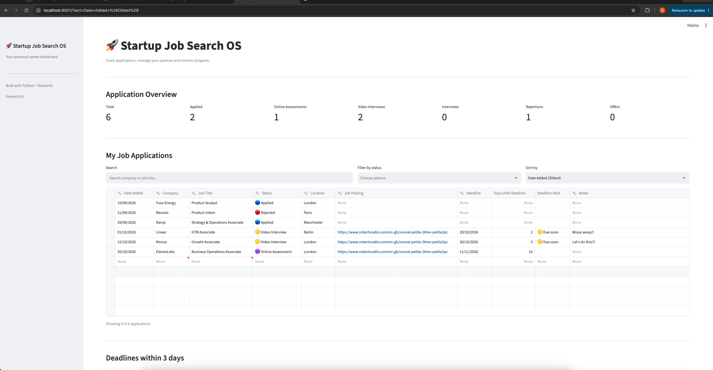

# 🚀 Startup Job Search OS

A personal job application tracking web app built with Python and Streamlit to organise startup opportunities, monitor application progress, and manage upcoming deadlines.

## Preview



## The Problem

Applying to startups can involve managing dozens of opportunities across different job boards, company websites and recruitment processes.

Traditional spreadsheets are useful, but manually updating application statuses, calculating deadlines and tracking progress can become repetitive.

I wanted to build a simple, centralised tool that would make my own startup job search more organised while developing practical programming and product-building skills.

## The Solution

Startup Job Search OS is a lightweight, spreadsheet-style web application that allows users to manage their job applications in one place.

It combines an editable application tracker with automatic data saving, search and filtering, deadline tracking and basic analytics.

The application is designed to be simple to use without requiring technical knowledge.

## Key Features

- **Editable application tracker:** Add, edit and delete applications directly in a spreadsheet-style interface.
- **Automatic saving:** Changes are saved to a CSV file without requiring a separate Save button.
- **Application status tracking:** Track progress across application, assessment, interview, offer and rejection stages.
- **Search, filter and sort:** Find opportunities by company, job title, application status or date.
- **Deadline management:** Automatically calculate days remaining until an application deadline and flag approaching deadlines.
- **Application analytics:** View summary metrics for applications, assessments, interviews, rejections and offers.
- **Persistent preferences:** Retain search, filtering and sorting selections when refreshing the page.
- **Automatic date tracking:** New records receive a default creation date.

## Technology Stack

| Technology   | Purpose                                       |
| ------------ | --------------------------------------------- |
| Python       | Application logic and data processing         |
| Streamlit    | Interactive web interface and editable tables |
| Pandas       | Data manipulation, filtering and analytics    |
| CSV          | Local data storage                            |
| Git & GitHub | Version control and source code hosting       |

## Getting Started

### Prerequisites

- Python 3 installed
- Git installed

### Installation

**1. Clone the repository**

```bash
git clone https://github.com/Scuderia24/startup-job-tracker.git
cd startup-job-tracker
```

**2. Create and activate a virtual environment**

```bash
python3 -m venv .venv
source .venv/bin/activate
```

On Windows, activate the environment using `.venv\Scripts\activate`.

**3. Install dependencies**

```bash
python -m pip install -r requirements.txt
```

**4. Launch the application**

```bash
python -m streamlit run app.py
```

The application should open in your browser, usually at `http://localhost:8501`.

A new CSV file is created when the first application is saved. Existing CSV data remains local and is not included in the public repository.

## How It Works

1. The application loads existing job records from a local CSV file.
2. Pandas converts the records into a DataFrame.
3. Streamlit displays the data in an interactive, editable table.
4. Users can add, update, delete, search, filter and sort applications.
5. Changes trigger an autosave function that updates the CSV file.
6. Dashboard metrics and deadline calculations are generated from the latest application data.

## What I Learned

This was my first substantial Python side project and helped me move from basic programming exercises towards building a usable product.

**Python fundamentals:** Working with variables, lists, dictionaries, loops, functions and conditional logic.

**Data handling:** Using pandas DataFrames to structure, filter, sort and analyse information.

**Building interfaces:** Using Streamlit to create interactive forms, tables, dashboards and controls.

**Data persistence:** Reading and writing CSV files so information remains available between sessions.

**Event-driven programming:** Using callbacks and session state to respond to user edits and automatically save changes.

**Debugging:** Identifying and fixing data-type issues, handling missing values and testing how application components interact.

**Product thinking:** Starting with a real personal problem, building a working solution and improving it through repeated testing and feedback.

## Future Improvements

Potential next steps include:

- Moving from CSV storage to a SQLite database.
- Improving validation and handling of incomplete records.
- Adding more advanced application analytics.
- Deploying the app for easier access.
- Exploring AI-assisted job research and application workflows.

## Project Status

**Version 0.6 — Working local prototype**

The application is currently designed for personal use and runs locally using Streamlit.

---

Built as a personal learning project to develop technical, analytical and product-building skills while exploring opportunities in startups.
