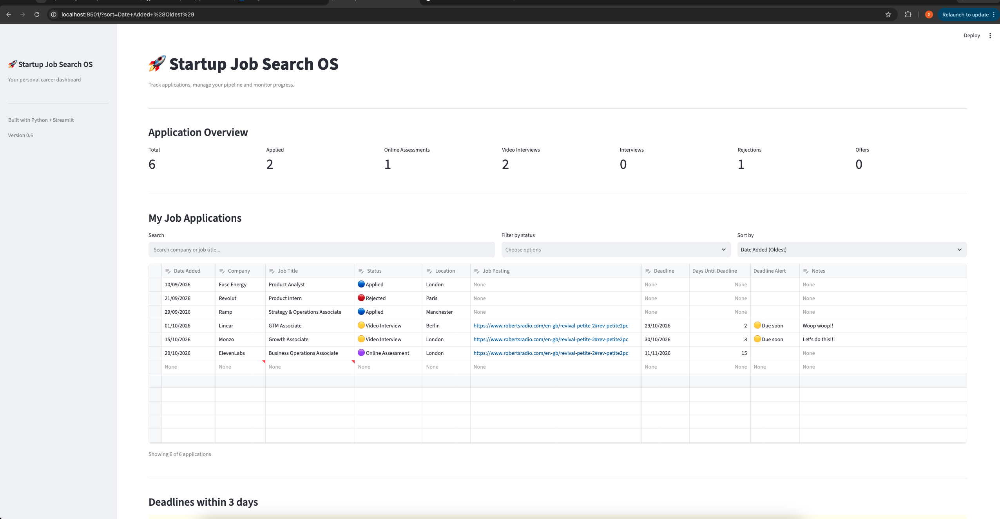

# 🚀 Startup Job Search OS

A personal job application tracking web app built with Python and Streamlit to organise startup opportunities, monitor application progress, and manage upcoming deadlines. Data is stored in a local SQLite database.

## Preview



## The Problem

Applying to startups can involve managing dozens of opportunities across different job boards, company websites and recruitment processes.

Traditional spreadsheets are useful, but manually updating application statuses, calculating deadlines and tracking progress can become repetitive.

I wanted to build a simple, centralised tool that would make my own startup job search more organised while developing practical programming and product-building skills.

## The Solution

Startup Job Search OS is a lightweight, spreadsheet-style web application that allows users to manage their job applications in one place.

It combines an editable application tracker with automatic saving to a SQLite database, search and filtering, deadline tracking, and SQL-powered pipeline reporting.

The application is designed to be simple to use without requiring technical knowledge.

## Key Features

- **Editable application tracker:** Add, edit and delete applications directly in a spreadsheet-style interface.
- **Automatic saving:** Changes are saved to a SQLite database without requiring a separate Save button. Each save is a single all-or-nothing transaction, so a crash mid-save cannot leave the data half-written.
- **CSV backup:** Every save also writes a readable CSV copy of the data as a backup.
- **Application status tracking:** Track progress across application, assessment, interview, offer and rejection stages.
- **Search, filter and sort:** Find opportunities by company, job title, application status or date.
- **Deadline management:** Automatically calculate days remaining until an application deadline and flag approaching deadlines.
- **Application analytics:** View summary metrics for applications, assessments, interviews, rejections and offers.
- **Pipeline dashboard:** A separate reporting page, built with SQL queries, showing total applications, response rate, applications by status and applications missing a deadline.
- **Persistent preferences:** Retain search, filtering and sorting selections when refreshing the page.
- **Automatic date tracking:** New records receive a default creation date.

## Technology Stack

| Technology   | Purpose                                       |
| ------------ | --------------------------------------------- |
| Python       | Application logic and data processing         |
| Streamlit    | Interactive web interface and editable tables |
| Pandas       | Data manipulation, filtering and analytics    |
| SQLite & SQL | Local database storage and reporting queries  |
| CSV          | Data import and automatic backup              |
| Git & GitHub | Version control and source code hosting       |

## Getting Started

### Prerequisites

- Python 3 installed
- Git installed

### Installation

#### 1. Clone the repository

```bash
git clone https://github.com/Scuderia24/startup-job-tracker.git
cd startup-job-tracker
```

#### 2. Create and activate a virtual environment

```bash
python3 -m venv .venv
source .venv/bin/activate
```

On Windows, activate the environment using `.venv\Scripts\activate`.

#### 3. Install dependencies

```bash
python -m pip install -r requirements.txt
```

#### 4. Create the database

The app reads from a SQLite database called `tracker.db`. Create it from an `applications.csv` file:

```bash
python import_csv.py
```

The script prints how many rows it read from the CSV and how many are in the database, so you can confirm nothing was lost. It rebuilds the database from the CSV each time it runs, so only re-run it if you deliberately want to do that.

`applications.csv` needs at least a header row: `id,date,company,role,status,location,job_link,deadline,notes`.

#### 5. Launch the application

```bash
python -m streamlit run app.py
```

The application should open in your browser, usually at `http://localhost:8501`.

#### 6. (Optional) Launch the pipeline dashboard

```bash
python -m streamlit run pipeline_dashboard.py
```

Personal data (`tracker.db`, `applications.csv` and backups) stays local and is excluded from the public repository via `.gitignore`.

## How It Works

1. The application loads job records from the SQLite database using a SQL query.
2. Pandas converts the records into a DataFrame.
3. Streamlit displays the data in an interactive, editable table.
4. Users can add, update, delete, search, filter and sort applications.
5. Each edit triggers an autosave function, which reloads the latest data, applies the change and saves the full table back to the database in a single transaction, then writes a CSV backup.
6. Dashboard metrics and deadline calculations are generated from the latest application data. Values that change daily, such as days until a deadline, are calculated on load rather than stored.

All reading and writing of data happens in two functions (`load_applications` and `save_applications`), which kept the move from CSV to SQLite contained to a small part of the code.

## Project Structure

| File | Purpose |
| ---- | ------- |
| `app.py` | Main Streamlit application |
| `pipeline_dashboard.py` | SQL-powered pipeline reporting page |
| `import_csv.py` | Builds `tracker.db` from `applications.csv` and verifies row counts |
| `pipeline_report.py` | Command-line version of the pipeline report |
| `main.py` | Original command-line tracker (first version of the project) |
| `database_test.py`, `sql_practice.py`, `delete_practice.py`, `aggregation_practice.py` | SQL learning exercises |

## What I Learned

This was my first substantial Python side project and helped me move from basic programming exercises towards building a usable product.

**Python fundamentals:** Working with variables, lists, dictionaries, loops, functions and conditional logic.

**Data handling:** Using pandas DataFrames to structure, filter, sort and analyse information.

**Building interfaces:** Using Streamlit to create interactive forms, tables, dashboards and controls.

**Data persistence:** Reading and writing CSV files, then migrating storage to a SQLite database without losing data.

**SQL and databases:** Writing queries with `SELECT`, `WHERE`, `UPDATE`, `DELETE`, `COUNT` and `GROUP BY`; designing a table schema; and using transactions so saves are all-or-nothing.

**Safe changes:** Backing up data, working on a separate Git branch, reviewing changes with `git diff`, and testing against a checklist before merging.

**Event-driven programming:** Using callbacks and session state to respond to user edits and automatically save changes.

**Debugging:** Identifying and fixing data-type issues, handling missing values and testing how application components interact.

**Product thinking:** Starting with a real personal problem, building a working solution and improving it through repeated testing and feedback.

## Future Improvements

Potential next steps include:

- Improving validation and handling of incomplete records.
- Adding more advanced application analytics.
- Saving only the changed row on each edit, rather than rewriting the full table.
- Allowing first-time setup without an existing CSV file.
- Deploying the app for easier access (this would require a hosted database, as free hosting platforms do not keep local files between restarts).
- Exploring AI-assisted job research and application workflows.

## Project Status

### Version 0.7 — Working local prototype on SQLite

The application is currently designed for personal use and runs locally using Streamlit.

---

Built as a personal learning project to develop technical, analytical and product-building skills while exploring opportunities in startups.
